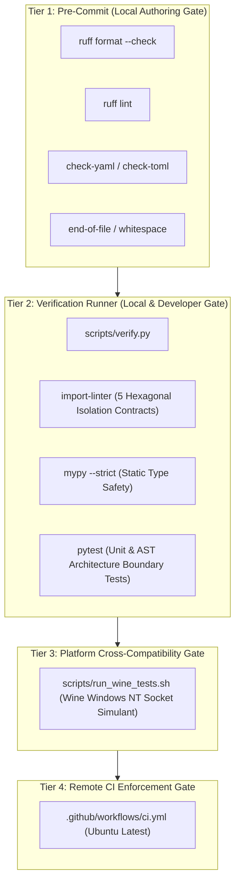

# ADR 0001: Scope and Boundary Enforcement Mechanisms

## Context and Problem Statement

`ed-transport` is the foundational, resilient network transport library for the Elite Dangerous integration fleet (`ed-capi`, `ed-eddn`, `ed-connectors`, and local `ed-telemetry` consumers). As defined across its functional specifications (`UC-01` through `UC-04`), the package has explicit in-scope responsibilities (bidirectional HTTP mechanics, token-bucket/sliding-window rate-limiting, authentication header injection, exponential retry backoff with jitter, offline bounded request spooling, and chunked SSE transport) and strict out-of-scope boundaries (zero domain data parsing, zero game schema validation, zero OAuth2 user grant negotiation, zero application logging configuration, and zero persistent database management).

In growing distributed codebases, architectural boundaries documented only in prose frequently suffer from architectural drift and scope creep:
1. Developers may inadvertently import domain modeling entities (from the planned `ed-models` package or game journals) into transport abstractions (`RISK-10`).
2. External HTTP engine libraries (`httpx`, `requests`, `urllib3`) risk leaking beyond the adapter perimeter into domain core or ports (`RISK-05`).
3. Domain logic (such as EDDN JSON Schema validation or Inara payload translation) risks being added to transport filters rather than downstream callers.
4. Security violations (credential leakage in URLs or exceptions, `RISK-08`) can bypass manual code review.

How should `ed-transport` deterministically enforce the scope and boundaries defined in `UC-01` through `UC-04` using automated verification gates?

---

## Decision Drivers

* **Zero Domain Knowledge (Total Model Agnosticism):** `ed-transport` core must operate exclusively on raw `bytes`, `str`, or primitive streams without knowledge of Elite Dangerous journals or game entities (`UC-04`).
* **Deterministic Layer Isolation:** Strict inward dependency direction (Hexagonal Architecture / Ports and Adapters) where adapters depend on core ports, never vice versa (`RISK-05`).
* **Multi-Tier Automated Enforcement:** Prevent boundary violations at authoring time (pre-commit hooks), local verification (`scripts/verify.py`), unit/architecture testing (`pytest`, `pytest-archon`), and remote integration gates (GitHub Actions CI pipeline).
* **Actionable and Rapid Feedback:** Gate failures must pinpoint exact AST nodes, violating imports, or leaked headers within seconds.

---

## Considered Options

* **Option 1: Informal Guidelines and Code Review.** Rely purely on written documentation, use-case specifications, and peer review. *(Rejected: Unreliable; easily regresses during refactors or urgent patches).*
* **Option 2: Single-Point CI Boundary Checks.** Run import boundary checks only in GitHub Actions CI workflows. *(Rejected: Slow feedback loop; developers only discover boundary violations after pushing commits and opening pull requests).*
* **Option 3: Multi-Tier Deterministic Enforcement Pipeline.** Combine Pytest AST inspection suites, `import-linter` contracts, pre-commit hygiene hooks, and unified verification scripts (`scripts/verify.py`) executed both locally and identically in CI.

---

## Decision Outcome

Chosen Option: **Option 3: Multi-Tier Deterministic Enforcement Pipeline**.

### System Boundary & Scope Enforcement Matrix

The following matrix systematically maps all in-scope capabilities and out-of-scope constraints from `UC-01` through `UC-04` directly to their automated enforcement mechanisms:

| Use Case | Boundary Category | Requirement / Constraint Description | Enforcement Mechanism | Verification Tooling & Rule Reference |
| :--- | :--- | :--- | :--- | :--- |
| **UC-01** | In-Scope | **Bidirectional HTTP Transport:** Dispatches `GET`, `POST`, `PUT`, `DELETE` using immutable, typed DTOs. | Unit / Contract Tests | `pytest tests/unit/test_http_dto.py`, AST immutability checks (`test_boundaries.py`). |
| **UC-01** | In-Scope | **Rate Limiting & Retries:** Token bucket and sliding window rate limits; exponential backoff with decorrelated jitter. | Unit & Property Tests | `pytest tests/unit/test_rate_limiter.py`, `pytest tests/unit/test_retry_policy.py`. |
| **UC-01** | In-Scope | **Credential Header Injection:** Pluggable `CredentialProvider` injecting Bearer/Basic/API keys via headers only. | Security Unit Tests & AST | `pytest tests/unit/test_auth.py`, test verifying API keys are never accepted in URL query parameters (`RISK-08`). |
| **UC-01** | Out-of-Scope | **Game Domain Modeling:** Zero parsing of Elite Dangerous journals, events, or telemetry entities. | AST & Import Linter | `.importlinter` (`core_domain_isolation`), `pytest tests/architecture/test_boundaries.py` banning `ed_models` imports. |
| **UC-01** | Out-of-Scope | **Third-Party Schema Validation:** No JSON-Schema validation of EDDN, Inara, or Frontier CAPI payloads. | AST Scanner & Import Linter | AST test asserting zero imports of `jsonschema`, `pydantic` in `core/` or `ports/`. |
| **UC-01** | Out-of-Scope | **OAuth2 Interactive Handshakes:** No browser redirection, local redirect listeners, or PKCE verifier generation. | Static Analysis & Archon | AST test asserting zero OAuth2 grant interactors in `ed_transport`; port restricted to credential resolution. |
| **UC-01** | Out-of-Scope | **Application Logging Setup:** No configuring root loggers or disk handlers inside the library. | AST Inspection | `test_boundaries.py` asserting no calls to `logging.basicConfig()` or root handler additions. |
| **UC-01** | Out-of-Scope | **Database Schema / Persistence:** No relational databases, migrations, or persistent tables. | Import Linter | `.importlinter` banning `sqlite3`, `sqlalchemy`, `alembic` from `core/` and `ports/`. |
| **UC-02** | In-Scope | **Bounded Offline Request Spooling:** Circular FIFO buffering with capacity limits and memory ceilings ($\le 10 \text{ MB}$). | Resource & Unit Tests | `pytest tests/unit/test_spool_buffer.py` testing boundary enforcement, drop-oldest, and reject-newest policies. |
| **UC-02** | In-Scope | **Rate-Limited Draining:** Drains spooled requests honoring destination rate limits and batch constraints. | Use Case Integration Tests | `pytest tests/unit/test_drain_spool_use_case.py`. |
| **UC-02** | Out-of-Scope | **OS Network Interface Monitoring:** No low-level OS interface sniffing or Wi-Fi state polling. | Dependency Scanner | AST test ensuring zero imports of `psutil`, `netifaces`, or raw OS socket ioctls; reachability tested via standard socket probes. |
| **UC-02** | Out-of-Scope | **Semantic Urgency Inspection:** No inspecting telemetry payload urgency (e.g. combat vs trade priority). | Unit / Interface Test | Port signature test asserting `SpoolItem` treats payload as opaque `bytes` without priority introspection fields. |
| **UC-02** | Out-of-Scope | **Payload Mutation:** Telemetry content and timestamps remain unaltered during spooling. | Invariance Tests | `pytest tests/unit/test_spool_invariants.py` verifying cryptographic digest identity of dequeued payloads. |
| **UC-03** | In-Scope | **Persistent SSE Client & IPC:** Connects to `ed-telemetry`, parses chunked SSE wire streams (`event`, `data`, comments). | Protocol Unit Tests | `pytest tests/unit/test_sse_parser.py`, mock server stream tests. |
| **UC-03** | In-Scope | **Watchdog Reconnection:** Exponential backoff reconnection when local daemon restarts or disconnects. | Concurrency Tests | `pytest tests/unit/test_stream_watchdog.py`. |
| **UC-03** | Out-of-Scope | **Event Deserialization:** No parsing raw SSE JSON data into domain event objects. | AST & Type Checks | `Mypy` and AST tests confirming `TelemetryStreamPort` yields raw `bytes` or `str` to downstream listeners. |
| **UC-03** | Out-of-Scope | **State Aggregation:** No maintaining commander state, loadouts, or history. | Import Linter | `.importlinter` banning `ed_state` or stateful tracking classes. |
| **UC-03** | Out-of-Scope | **Daemon Lifecycle Management:** No starting, stopping, or spawning `ed-telemetry` systemd services/subprocesses. | AST Scanner | AST test asserting zero calls to `subprocess.Popen` or OS service managers in transport engine. |
| **UC-04** | In-Scope | **Opaque Payload Handling:** Accepts and returns raw `bytes`, `str`, or binary generators across all driving ports. | Port Signature AST Tests | `pytest tests/architecture/test_boundaries.py` inspecting parameter and return annotations of all ports. |
| **UC-04** | In-Scope | **Architectural Gate Verification:** Deterministic verification runner (`scripts/verify.py`) executed locally and in CI. | CI Pipeline & Script | `.github/workflows/ci.yml` invoking `uv run python scripts/verify.py`. |
| **UC-04** | Out-of-Scope | **Game Domain Entities & Enums:** Zero knowledge of star systems, ship modules, commodities, or journal types. | Import Linter & AST | `.importlinter` forbidden contract banning `ed_models.*`; AST check failing if `ed_models` is imported. |
| **UC-04** | Out-of-Scope | **Serialization / Deserialization:** Zero Pydantic or Msgspec schema mapping of game payloads. | AST Scanner | AST test verifying `core/domain` and `core/use_cases` contain zero model deserialization logic. |
| **UC-04** | Out-of-Scope | **Semantic Error Interpretation:** Does not interpret business errors inside HTTP 200 responses. | Contract Tests | Unit tests verifying `HttpResponse` returns raw status codes without evaluating application-specific JSON error envelopes. |

---

## Architectural Enforcement Architecture

The enforcement mechanisms are structured across four operational tiers:

### 1. Tier 1: Authoring Hygiene (`.pre-commit-config.yaml`)
* Enforces file formatting, trailing whitespace eradication, TOML/YAML syntax integrity, and Ruff linting rules (`UP`, `B`, `E`, `F`, `W`, `I`).
* Blocks dirty or non-conforming commits before they enter local git history.

### 2. Tier 2: Deterministic Verification Runner (`scripts/verify.py`)
* **`import-linter` Boundary Contracts:**
  * `core_domain_isolation`: Forbids `core.domain` from importing `adapters` or any external third-party framework.
  * `inward_dependency_direction`: Enforces strict directional layering (`adapters` $\rightarrow$ `use_cases` $\rightarrow$ `domain`).
  * `domain_port_isolation`: Prevents `domain` from referencing `ports` or `use_cases`.
  * `use_case_transport_isolation`: Forbids `use_cases` from importing concrete `adapters` or web frameworks (`fastapi`, `starlette`, `flask`, `click`, `typer`).
  * `composition_root_isolation`: Forbids `domain`, `ports`, `use_cases`, and `adapters` from referencing `bootstrap`.
* **AST Architecture Compliance Tests (`tests/architecture/test_boundaries.py`):**
  * Parses module abstract syntax trees to guarantee port contracts are abstract protocols/ABCs.
  * Asserts port signatures use exclusively primitives, frozen DTOs, and raw payload types (`bytes`, `str`).
  * Asserts zero forbidden module imports (`ed_models`, `jsonschema`, `psutil`, `sqlite3`, `sqlalchemy`).
* **Static Type Safety (`mypy`):**
  * Strict mode type checking (`--strict`) preventing untyped `Any` leakage across port interfaces.

### 3. Tier 3: Cross-Platform Socket Simulation (`scripts/run_wine_tests.sh`)
* Validates Windows NT socket behavior and errno mappings under Wine emulation to prevent platform-specific socket regressions (`RISK-09`).

### 4. Tier 4: Remote Continuous Integration (`.github/workflows/ci.yml`)
* Executes `scripts/verify.py` on every pull request and push to `main`.
* Protects the repository by requiring all quality and boundary gates to pass before PR merge approval.

---

## Consequences

### Positive
* **Deterministic Boundary Protection:** Scope boundaries from `UC-01` through `UC-04` are enforced by automated gates, preventing architectural decay.
* **Complete Decoupling from `ed-models`:** `ed-transport` can be versioned and released completely independently of Elite Dangerous game updates or schema revisions.
* **Early Defect Catching:** Violating imports or payload leaks fail in less than 2 seconds locally via `scripts/verify.py`.

### Negative / Trade-offs
* **Discipline Overhead:** Downstream callers (`ed-eddn`, `ed-capi`, `ed-connectors`) must handle domain serialization and schema validation before invoking `ed-transport`.
* **Testing Rigor:** Every new port or use-case requires corresponding AST test assertions in `test_boundaries.py`.
