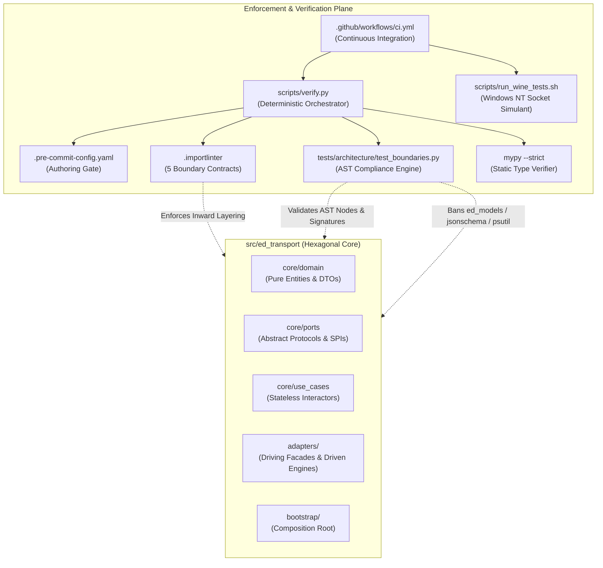
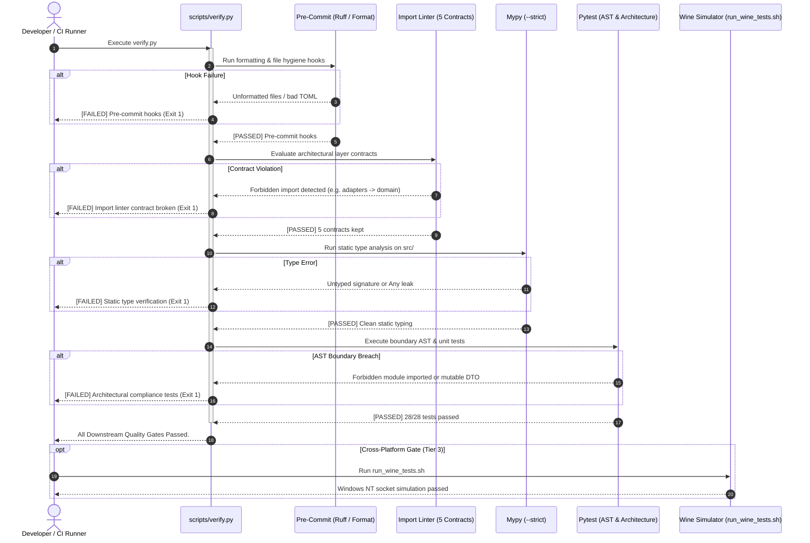

# SDD-001: Scope and Boundary Enforcement Architecture

## 1. Introduction and Architectural Motivation

### 1.1 Scope and Objective
This Software Design Document (SDD) specifies the structural architecture, component contracts, AST inspection engine, and multi-tier verification pipelines that deterministically enforce the scope boundaries and architectural constraints of `ed-transport`. It acts as the direct implementation design for [ADR 0001: Scope and Boundary Enforcement Mechanisms](file:///home/michael/src/github.com/mnaatjes/ed-transport/architecture/adr/0001_scope_and_boundary_enforcement_mechanisms.md), systematically translating the requirements of `UC-01` through `UC-04` and the Environmental/Technical boundaries of the Master Risk Register into executable quality gates.

### 1.2 The Skeptic Test (Why Build Automated Boundary Enforcement?)
In a distributed micro-package fleet (`ed-models`, `ed-transport`, `ed-capi`, `ed-eddn`, `ed-connectors`), boundary leakage poses severe operational risks:
1. **Accidental Domain Model Infiltration (`RISK-10`):** Without automated guards, developers writing transport clients will naturally import Pydantic/Msgspec models from `ed-models` or deserialize Elite Dangerous journal schemas directly inside transport interactors. This couples transport releases to game updates.
2. **Third-Party HTTP Engine Leakage (`RISK-05`):** Allowing `httpx`, `requests`, or `aiohttp` types to escape concrete driven adapters couples consumers directly to an engine, creating catastrophic dependency resolution conflicts in client apps.
3. **Silent Credential Leakage (`RISK-08`):** Manual code reviews reliably miss authorization tokens passed in URL query strings or reflected in exception messages.
4. **Platform Discrepancies (`RISK-09`):** Windows NT socket error codes (`WSA*`) behave differently than POSIX errnos under network interruptions; unverified code causes silent deadlocks on Windows and Steam Deck Proton runtimes.

Informal conventions and documentation fail under delivery pressure. Enforcing architectural boundaries at compile/lint time mathematically eliminates these failure modes before code merges to `main`.

### 1.3 The Vacation Test
This specification details the AST inspection visitors, import-linter contracts, pre-commit hooks, Wine test simulant execution, and verification runner scripts with sufficient technical precision that an independent engineer could completely implement, execute, and extend these enforcement mechanisms without consulting the original author.

---

## 2. Visual Architecture Models

### 2.1 Structural Component Model



### 2.2 Dynamic Verification Flow Model



---

## 3. Detailed Component Design & Specifications

### 3.1 Tier 1: Pre-Commit Authoring Gate (`.pre-commit-config.yaml`)
* **Execution:** Triggered on `git commit` or directly via `pre-commit run --all-files`.
* **Rules Enforced:**
  1. `trailing-whitespace`: Eradicates line-ending whitespace.
  2. `end-of-file-fixer`: Ensures clean newline termination across all text files.
  3. `check-yaml` / `check-toml`: Verifies syntactic integrity of configuration files.
  4. `ruff`: Enforces strict linting rules: `E` (Pycodestyle errors), `F` (Pyflakes), `W` (Warnings), `I` (isort import ordering), `B` (Flake8-bugbear anti-patterns), and `UP` (pyupgrade modern Python 3.12+ syntax).
  5. `ruff-format`: Enforces uniform code styling with a 100-character line ceiling.

### 3.2 Tier 2: Import Linter Isolation Engine (`.importlinter`)
Configured to analyze all modules rooted at `ed_transport` with external packages included:

```ini
[importlinter]
root_packages = ed_transport
include_external_packages = True

[importlinter:contract:core_domain_isolation]
name = core_domain_isolation
type = forbidden
source_modules = ed_transport.core.domain
forbidden_modules =
    ed_transport.adapters
    external
    frameworks
    ed_models

[importlinter:contract:inward_dependency_direction]
name = inward_dependency_direction
type = layers
layers =
    ed_transport.adapters
    ed_transport.core.use_cases
    ed_transport.core.domain

[importlinter:contract:domain_port_isolation]
name = domain_port_isolation
type = forbidden
source_modules = ed_transport.core.domain
forbidden_modules =
    ed_transport.core.ports
    ed_transport.core.use_cases

[importlinter:contract:use_case_transport_isolation]
name = use_case_transport_isolation
type = forbidden
source_modules = ed_transport.core.use_cases
forbidden_modules =
    ed_transport.adapters
    fastapi
    starlette
    flask
    click
    typer
    ed_models

[importlinter:contract:composition_root_isolation]
name = composition_root_isolation
type = forbidden
source_modules =
    ed_transport.core.domain
    ed_transport.core.ports
    ed_transport.core.use_cases
    ed_transport.adapters
forbidden_modules =
    ed_transport.bootstrap
```

### 3.3 Tier 2: AST Architecture Compliance Engine (`tests/architecture/test_boundaries.py`)
The AST compliance test suite inspects the Python Abstract Syntax Tree of all source files without executing module-level side-effects.

#### 3.3.1 Forbidden Dependencies Matrix
The AST scanner validates that specific external packages are strictly forbidden across architectural layers:

| Layer / Subsystem | Forbidden Imports | Rationale / Risk Reference |
| :--- | :--- | :--- |
| **All Layers (`src/ed_transport`)** | `ed_models`, `ed_models.*` | Total domain model agnosticism (`UC-04`, `RISK-10`). |
| **All Layers (`src/ed_transport`)** | `jsonschema`, `fastjsonschema` | No payload schema validation in transport (`UC-01`, `UC-04`). |
| **All Layers (`src/ed_transport`)** | `sqlite3`, `sqlalchemy`, `alembic` | Zero database persistence in transport core (`UC-01`). |
| **All Layers (`src/ed_transport`)** | `psutil`, `netifaces` | No OS hardware interface monitoring (`UC-02`). |
| **All Layers (`src/ed_transport`)** | `subprocess`, `os.system` | No daemon lifecycle management (`UC-03`). |
| **`core/domain`, `core/ports`** | `httpx`, `requests`, `aiohttp`, `urllib3` | Third-party HTTP engines restricted to `adapters/driven/engine` (`RISK-05`). |
| **`core/domain`, `core/ports`** | `logging.basicConfig`, `logging.getLogger().addHandler` | No root logging configuration side-effects (`UC-01`). |

#### 3.3.2 Port Signature Contract Checks
1. **Abstract Protocols / ABCs:** All port classes defined in `core/ports/` must inherit from `typing.Protocol`, `abc.ABC`, or declared port marker classes.
2. **Opaque Payload Signatures:** Methods on driving ports (`HttpTransportPort`, `TelemetryStreamPort`, `SpoolManagerPort`) must declare request and response body types strictly as `bytes`, `str`, or `typing.AsyncIterator[bytes]`. No Pydantic or generic model references are permitted.
3. **Immutable DTOs:** All domain entities and DTOs in `core/domain` must be decorated with `@dataclass(frozen=True)` or equivalent immutable structures to prevent shared-memory mutation bugs during asynchronous retries.

### 3.4 Tier 3: Cross-Platform Socket Simulator (`scripts/run_wine_tests.sh`)
* **Environment:** Wine running Python under Windows NT architecture.
* **Scope:** Executes unit tests against driven socket adapters (`adapters/driven/engine/`) to verify that Windows socket errors (`WSAECONNRESET`, `WSAETIMEDOUT`, `WSAEHOSTUNREACH`) map cleanly to domain network exceptions (`NetworkTransportError`, `ConnectionResetError`) without unhandled crashes (`RISK-09`).

### 3.5 Tier 4: CI Automation Workflow (`.github/workflows/ci.yml`)
* **Environment:** `ubuntu-latest` running Python 3.12 with Astral `uv`.
* **Workflow:**
  1. Synchronizes dependencies via `uv sync --all-extras`.
  2. Installs the local package in editable mode: `uv pip install -e .`.
  3. Executes `uv run python scripts/verify.py`.
  4. Fails fast on any lint, type, or boundary violation, preventing branch merge to `main`.

---

## 4. Verification and Implementation Plan

1. **Step 1: Baseline Architecture Suite Verification:** Run `scripts/verify.py` to confirm baseline compliance.
2. **Step 2: Incremental AST Assertions Addition:** As concrete port adapters and use cases are authored during the Construction phase:
   - Add explicit AST visitor tests in `tests/architecture/test_boundaries.py` for each forbidden dependency category.
   - Verify that test failures output clear, actionable error messages identifying the source file, line number, and offending AST node.
3. **Step 3: Pre-Push Guarding:** Ensure local pre-commit hooks and Wine tests pass before submitting pull requests.
