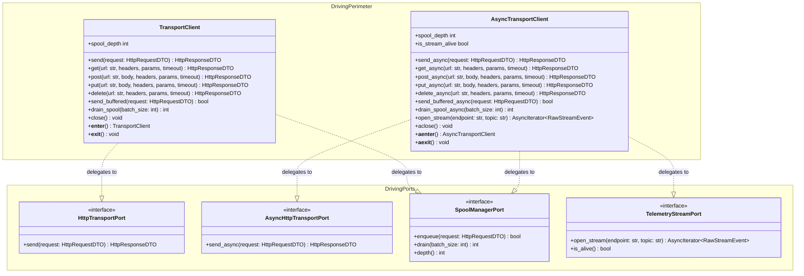

# SDD-002: TransportClient Driving Facade Implementation Architecture

## 1. Introduction and Architectural Motivation

### 1.1 Scope and Objective
This Software Design Document (SDD) specifies the concrete implementation architecture for the driving adapter facades (`TransportClient` and `AsyncTransportClient`) and their factory functions in `ed-transport`. It operationalizes [ADR 0002: Driving Adapter Facade Definition and API Surface](file:///home/michael/src/github.com/mnaatjes/ed-transport/architecture/adr/0002_driving_adapter_facade_definition.md) and establishes the complete outside-in contract, including parameter normalization, driving port mapping, context management, exception hierarchy, and an exhaustive pytest test suite plan.

### 1.2 The Skeptic Test (Why Build a Facade Instead of Direct Use-Case Calls?)
Without a dedicated driving facade:
1. Every consumer library (`ed-capi`, `ed-eddn`, `ed-connectors`) would have to write their own boilerplate wrapper to construct `HttpRequestDTO`s, coordinate token buckets, and manage connection pools.
2. Internal changes to use-case interactor constructors would break every downstream consumer in the fleet.
3. Client developers would risk instantiating async interactors from sync worker threads or calling sync blocking functions from within reactive async event loops, leading to intermittent process hangs (`RISK-07`).

A formal driving adapter facade guarantees a single, stable, ergonomically tested boundary into the Hexagonal Core.

### 1.3 The Vacation Test
This document details the exact class hierarchies, method signatures, parameter defaults, exception mapping, and test plans such that an independent engineer can implement `src/ed_transport/adapters/driving/client.py`, the corresponding driving port contracts in `core/ports/driving/`, and pass all associated unit/integration tests without consulting the author.

---

## 2. Visual Architecture Models

### 2.1 Structural Class & Port Model



### 2.2 Request Execution and Spool Fallback Sequence

```mermaid
sequenceDiagram
    autonumber
    actor Caller as Downstream Client (ed-eddn)
    participant Facade as TransportClient / AsyncTransportClient
    participant Port as HttpTransportPort (Use Case)
    participant Rate as RateLimiterPort
    participant Auth as CredentialProviderPort
    participant Engine as HttpEnginePort (Driven Adapter)
    participant Spool as SpoolStoragePort

    Caller->>Facade: post(url, body=payload_bytes)
    activate Facade
    Facade->>Facade: Construct frozen HttpRequestDTO

    Facade->>Port: send(HttpRequestDTO)
    activate Port
    Port->>Rate: acquire_token(destination_key)
    Rate-->>Port: Token granted

    Port->>Auth: resolve_headers()
    Auth-->>Port: {"Authorization": "Bearer ..."}

    Port->>Engine: execute_http_call(HttpRequestDTO)
    activate Engine
    alt Network Available (Online)
        Engine-->>Port: HttpResponseDTO(status_code=200, body=...)
        deactivate Engine
        Port-->>Facade: HttpResponseDTO
        Facade-->>Caller: HttpResponseDTO
    else Network Down & send_buffered active
        Engine--xPort: NetworkTransportError (Timeout/Unreachable)
        deactivate Engine
        Port->>Spool: enqueue(HttpRequestDTO)
        Spool-->>Port: True (Stored in FIFO)
        Port-->>Facade: True (Buffered)
        Facade-->>Caller: True
    end
    deactivate Port
    deactivate Facade
```

---

## 3. Component Design & Technical Specifications

### 3.1 Parameter Normalization & DTO Construction
The facade methods (`get`, `post`, `put`, `delete`) accept Python standard types and convert them into the immutable `HttpRequestDTO` contract:
* `url`: String URL. Validated for absolute HTTP/HTTPS scheme.
* `method`: Uppercase HTTP verb string (`"GET"`, `"POST"`, `"PUT"`, `"DELETE"`).
* `headers`: Optional mapping of strings. Copied into a frozen dictionary to prevent external mutation.
* `params`: Optional mapping of query string parameters. Formatted into query parameters (rejecting sensitive tokens, `RISK-08`).
* `body`: Converted to `bytes` if provided as `str` (UTF-8 encoded). If already `bytes`, passed directly. Model instances are rejected (`UC-04`).
* `timeout`: Optional float in seconds. Defaults to client-configured timeout.

### 3.2 Error Handling & Exception Mapping
The facade guarantees that internal socket exceptions or third-party HTTP engine errors never leak to callers:

| Internal / Driven Exception | Facade Raised Domain Exception | Diagnostic Payload |
| :--- | :--- | :--- |
| `SocketTimeout`, `ConnectTimeout` | `TransportTimeoutError` | `endpoint`, `timeout_seconds`, `attempt_count` |
| `ConnectionReset`, `BrokenPipe` | `TransportConnectionError` | `endpoint`, `root_cause_errno` |
| `HTTP 429` (Rate limit ceiling) | `RateLimitExceededError` | `destination`, `retry_after_seconds` |
| Exhausted retries | `MaxRetriesExceededError` | `endpoint`, `total_attempts`, `history` |
| Spool buffer full (RejectNewest) | `SpoolCapacityExceededError` | `current_depth`, `capacity_ceiling` |

---

## 4. Implementation Test Suite Plan (`pytest`)

The following test suites must be implemented in `tests/unit/test_transport_client.py` to achieve 100% boundary and use-case verification of the driving facade:

### 4.1 Unit Test Inventory: `test_transport_client.py`

```python
"""Test suite blueprint for TransportClient driving facade."""

import pytest
from ed_transport.adapters.driving.client import TransportClient, AsyncTransportClient
from ed_transport.core.domain.models import HttpRequestDTO, HttpResponseDTO
from ed_transport.core.domain.exceptions import (
    RateLimitExceededError,
    MaxRetriesExceededError,
    SpoolCapacityExceededError,
    InvalidPayloadTypeError,
)

# 1. Ergonomic HTTP Verb Dispatch Tests (UC-01)
def test_sync_client_get_dispatches_proper_dto():
    """Verify client.get() builds a frozen GET HttpRequestDTO and returns response."""
    ...

def test_sync_client_post_serializes_str_body_to_bytes():
    """Verify client.post(..., body='text') encodes string to UTF-8 bytes."""
    ...

def test_sync_client_post_preserves_raw_bytes():
    """Verify client.post(..., body=b'\x00\x01') preserves byte identity (UC-04)."""
    ...

def test_sync_client_rejects_arbitrary_objects_as_body():
    """Verify client.post(..., body=dict()) raises InvalidPayloadTypeError (UC-04)."""
    ...

# 2. Context Manager Lifecycle Tests
def test_sync_client_context_manager_closes_resources():
    """Verify with TransportClient(...) closes underlying engine on exit."""
    ...

@pytest.mark.asyncio
async def test_async_client_context_manager_closes_resources():
    """Verify async with AsyncTransportClient(...) closes underlying engine on aexit."""
    ...

# 3. Spooling & Buffering Tests (UC-02)
def test_send_buffered_enqueues_on_network_down():
    """Verify send_buffered returns True and increments spool_depth when offline."""
    ...

def test_drain_spool_dispatches_queued_items_in_fifo_order():
    """Verify drain_spool() dispatches enqueued requests in chronological order."""
    ...

def test_spool_capacity_eviction_drop_oldest():
    """Verify circular buffer drops oldest item when capacity limit is reached."""
    ...

# 4. SSE Stream Transport Tests (UC-03)
@pytest.mark.asyncio
async def test_open_stream_yields_raw_event_chunks():
    """Verify open_stream() demuxes SSE chunks and yields RawStreamEvent items."""
    ...

@pytest.mark.asyncio
async def test_open_stream_watchdog_reconnects_on_disconnect():
    """Verify watchdog detects heartbeat loss and triggers reconnect backoff."""
    ...
```

---

## 5. Verification Plan

1. **Step 1: Test Double Setup:** Create in-memory stubs (`tests/doubles/fake_engine.py`, `fake_spool.py`) in compliance with `test_boundaries.py`.
2. **Step 2: Driving Ports Definition:** Declare `HttpTransportPort`, `AsyncHttpTransportPort`, `SpoolManagerPort`, `TelemetryStreamPort` in `core/ports/driving/`.
3. **Step 3: Facade Implementation:** Implement `TransportClient` and `AsyncTransportClient` in `src/ed_transport/adapters/driving/client.py`.
4. **Step 4: Quality Gate Run:** Run `.venv/bin/python scripts/verify.py` to confirm zero lint errors, 100% type safety, and all boundary contracts kept.
