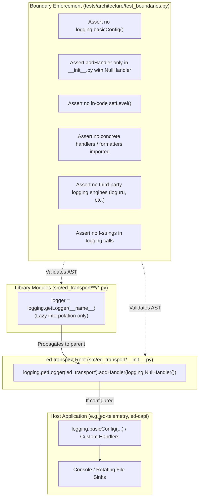
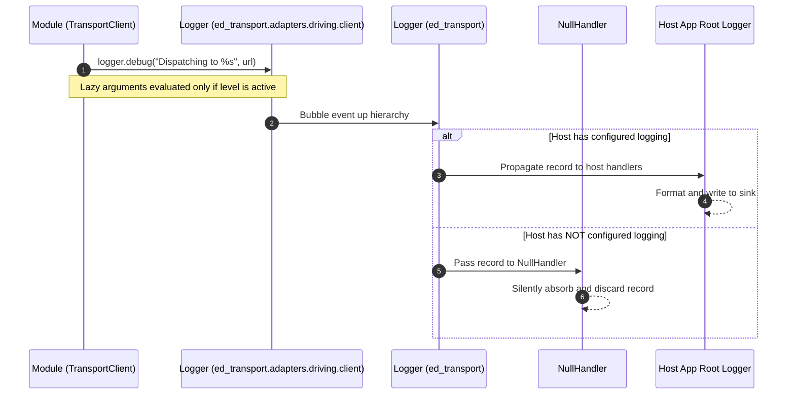

# SDD-003: Shared Library Logging and AST Boundary Enforcement Architecture

## 1. Introduction and Motivation

### 1.1 Scope and Objective
This Software Design Document specifies the concrete architecture and automated AST verification mechanisms implementing [ADR 0003: Shared Library Logging Architecture and Boundary Enforcement](file:///home/michael/src/github.com/mnaatjes/ed-transport/architecture/adr/0003_shared_library_logging_architecture_and_boundary_enforcement.md). It guarantees strict compliance with PEP 2818 and prevents library logging pollution across the *Elite Dangerous* software fleet.

### 1.2 The Skeptic Test (Why Build Automated Logging Boundary Enforcement?)
Without automated static enforcement:
1. **Host Log Hijacking:** Developers accidentally call `logging.basicConfig()` inside library helpers, overriding host application formatting, levels, and destination sinks.
2. **Stderr Noise & Warnings:** Omitting `NullHandler` produces `No handlers could be found for logger "ed_transport"` warnings in minimal consumer test suites.
3. **Format Overhead:** Using f-strings (`logger.debug(f"...")`) evaluates expensive string operations even when debug logging is disabled in production.
4. **Unwanted Sinks:** Developers inadvertently attach console or file handlers during debugging and commit them to version control.

### 1.3 The Vacation Test
This specification provides complete AST node inspection logic, exact code additions, and test assertions such that any engineer can implement, maintain, and verify the logging enforcement suite independently.

---

## 2. Visual Architecture Models

### 2.1 Structural Component Model



### 2.2 Logging Event Flow Model



---

## 3. Implementation Details

### 3.1 Root Handler Binding (`src/ed_transport/__init__.py`)

```python
import logging

# PEP 2818: Absorb all library logging silently if host has not configured logging.
logging.getLogger("ed_transport").addHandler(logging.NullHandler())
```

### 3.2 Opt-In Fleet Logging Bootstrap Factory (`src/ed_transport/bootstrap/logging.py`)

Provides the reusable logging bootstrap helper for fleet applications (`ed-capi`, `ed-eddn`, `ed-connectors`):

```python
from __future__ import annotations

import logging
from logging.handlers import RotatingFileHandler
import os
from pathlib import Path
import sys

def get_platform_log_dir(app_name: str) -> Path:
    """Returns canonical OS log directory according to Homelab Systems Lifecycle standards."""
    if sys.platform == "win32":
        local_app_data = os.environ.get("LOCALAPPDATA", str(Path.home() / "AppData" / "Local"))
        return Path(local_app_data) / app_name / "logs"
    return Path.home() / ".local" / "state" / app_name / "logs"

def configure_fleet_logging(
    app_name: str,
    log_dir: Path | None = None,
    level: int = logging.INFO,
    max_bytes: int = 5 * 1024 * 1024,
    backup_count: int = 5,
) -> Path:
    """Configures standardized rotating file logging for fleet daemon applications."""
    target_dir = log_dir or get_platform_log_dir(app_name)
    target_dir.mkdir(parents=True, exist_ok=True)
    log_file = target_dir / f"{app_name}.log"

    root_logger = logging.getLogger()
    root_logger.setLevel(level)

    handler = RotatingFileHandler(
        filename=log_file,
        maxBytes=max_bytes,
        backupCount=backup_count,
        encoding="utf-8",
    )
    formatter = logging.Formatter(
        "%(asctime)s [%(levelname)s] %(name)s (%(process)d): %(message)s"
    )
    handler.setFormatter(formatter)
    root_logger.addHandler(handler)

    return log_file
```

### 3.3 AST Verification Functions (`tests/architecture/test_boundaries.py`)

1. **`test_logging_forbids_process_wide_configuration()`**:
   * Walks all AST nodes in `src/ed_transport/`.
   * Forbids any `ast.Call` where `func.attr == "basicConfig"`.

2. **`test_logging_restricts_add_handler_calls()`**:
   * Scans all `ast.Call` nodes where `func.attr == "addHandler"`.
   * Asserts calls are only permitted in:
     - `src/ed_transport/__init__.py` (passing `NullHandler`)
     - `src/ed_transport/bootstrap/logging.py` (passing `RotatingFileHandler`)

3. **`test_logging_forbids_in_code_set_level()`**:
   * Asserts `.setLevel()` is never invoked outside `src/ed_transport/bootstrap/logging.py`.

4. **`test_logging_forbids_concrete_handlers_and_formatters_outside_bootstrap()`**:
   * Forbids importing `StreamHandler`, `FileHandler`, `RotatingFileHandler`, `TimedRotatingFileHandler`, `SysLogHandler`, `SocketHandler`, `MemoryHandler`, `HTTPHandler`, and `Formatter` anywhere outside `src/ed_transport/bootstrap/logging.py`.

5. **`test_logging_forbids_third_party_engines()`**:
   * Forbids importing from `loguru`, `structlog`, `rich.logging`, or `sentry_sdk`.

6. **`test_logging_enforces_lazy_formatting()`**:
   * Inspects `ast.Call` nodes where `func.attr` is in `("debug", "info", "warning", "error", "critical", "exception")`.
   * Asserts `node.args[0]` is not an `ast.JoinedStr` (f-string).

---

## 4. Documentation Implementation Steps

In accordance with Diataxis standards, the implementation of this subsystem must include:

1. **`docs/how-to/configure_fleet_logging.md`**:
   * Practical recipes for daemon applications (`ed-capi`, `ed-eddn`, `ed-connectors`) to initialize rotating file logs via `configure_fleet_logging()`.
   * Details on default log directory resolution (`~/.local/state/` vs `%LOCALAPPDATA%`), rotation thresholds, and log level arguments.
2. **`docs/reference/transport_client.md`**:
   * Add `ed_transport.bootstrap.logging` to exported reference symbols.
   * Document `configure_fleet_logging` signature, parameters, return type, and platform path resolution.

---

## 5. Verification Plan

* Run `.venv/bin/python scripts/verify.py` to ensure pre-commit, import-linter, mypy, and all pytest tests pass.
