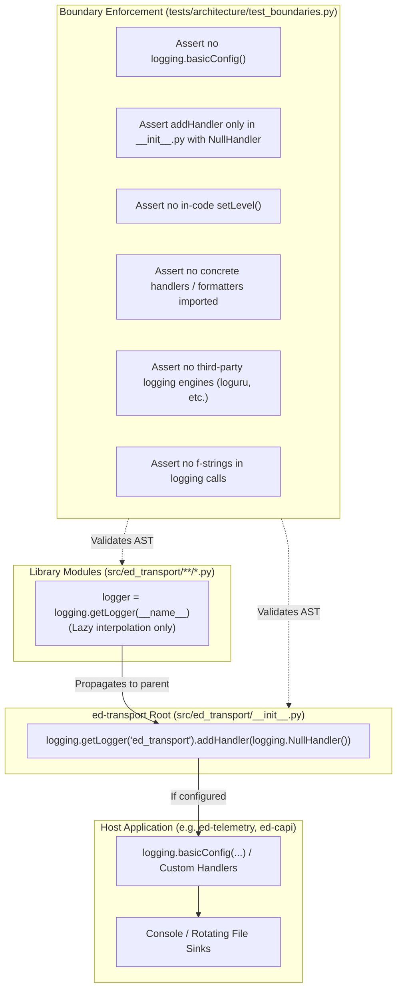
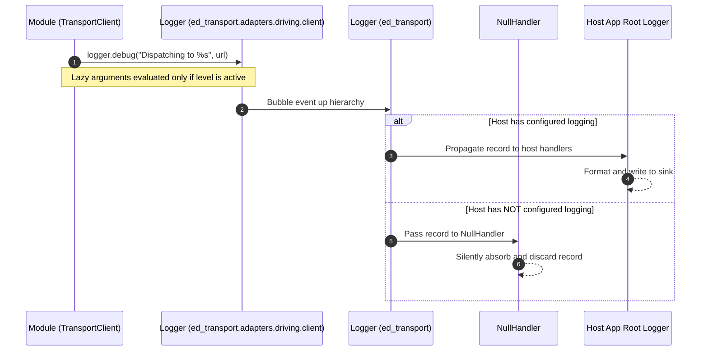

# SDD-003: Shared Library Logging and AST Boundary Enforcement Architecture

## 1. Introduction and Motivation

### 1.1 Scope and Objective
This Software Design Document specifies the concrete architecture and automated AST verification mechanisms implementing [ADR 0003: Shared Library Logging Architecture and Boundary Enforcement](file:///home/michael/src/github.com/mnaatjes/ed-transport/architecture/adr/0003_shared_library_logging_architecture_and_boundary_enforcement.md). It guarantees strict compliance with PEP 2818 and prevents library logging pollution across the *Elite Dangerous* software fleet.

### 1.2 The Skeptic Test (Why Build Automated Logging Boundary Enforcement?)
Without automated static enforcement:
1. **Host Log Hijacking:** Developers accidentally call `logging.basicConfig()` inside library helpers, overriding host application formatting, levels, and destination sinks.
2. **Stderr Noise & Warnings:** Omitting `NullHandler` produces `No handlers could be found for logger "ed_transport"` warnings in minimal consumer test suites.
3. **Format Overhead:** Using f-strings (`logger.debug(f"...")`) evaluates expensive string operations even when debug logging is disabled in production.
4. **Unwanted Sinks:** Developers inadvertently attach console or file handlers during debugging and commit them to version control.

### 1.3 The Vacation Test
This specification provides complete AST node inspection logic, exact code additions, and test assertions such that any engineer can implement, maintain, and verify the logging enforcement suite independently.

---

## 2. Visual Architecture Models

### 2.1 Structural Component Model



### 2.2 Logging Event Flow Model



---

## 3. Implementation Details

### 3.1 Root Handler Binding (`src/ed_transport/__init__.py`)

```python
import logging

# PEP 2818: Absorb all library logging silently if host has not configured logging.
logging.getLogger("ed_transport").addHandler(logging.NullHandler())
```

### 3.2 AST Verification Functions (`tests/architecture/test_boundaries.py`)

1. **`test_logging_forbids_process_wide_configuration()`**:
   * Walks all AST nodes in `src/ed_transport/`.
   * Forbids any `ast.Call` where `func.attr == "basicConfig"`.

2. **`test_logging_restricts_add_handler_to_root_null_handler()`**:
   * Scans all `ast.Call` nodes where `func.attr == "addHandler"`.
   * Asserts only 1 call exists across the package, located in `src/ed_transport/__init__.py`.
   * Asserts the argument is an instantiation of `logging.NullHandler`.

3. **`test_logging_forbids_in_code_set_level()`**:
   * Scans all `ast.Call` nodes; asserts `func.attr != "setLevel"`.

4. **`test_logging_forbids_concrete_handlers_and_formatters()`**:
   * Scans `ast.Import` and `ast.ImportFrom` nodes.
   * Forbids importing `StreamHandler`, `FileHandler`, `RotatingFileHandler`, `TimedRotatingFileHandler`, `SysLogHandler`, `SocketHandler`, `MemoryHandler`, `HTTPHandler`, and `Formatter`.

5. **`test_logging_forbids_third_party_engines()`**:
   * Forbids importing from `loguru`, `structlog`, `rich.logging`, or `sentry_sdk`.

6. **`test_logging_enforces_lazy_formatting()`**:
   * Inspects `ast.Call` nodes where `func.attr` is in `("debug", "info", "warning", "error", "critical", "exception")`.
   * Asserts `node.args[0]` is not an `ast.JoinedStr` (f-string).

---

## 4. Verification Plan

* Run `.venv/bin/python scripts/verify.py` to ensure pre-commit, import-linter, mypy, and all pytest tests pass.
