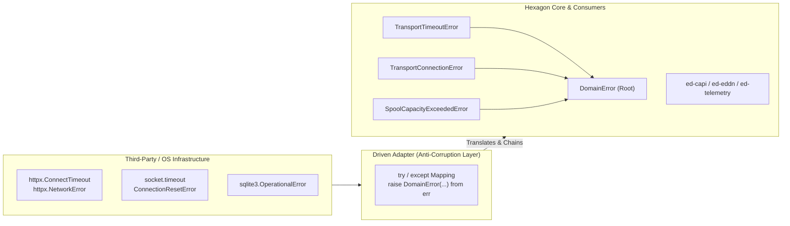
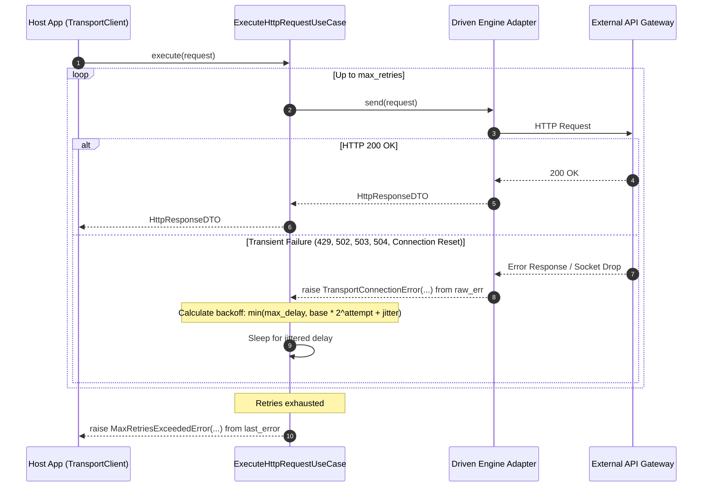

# SDD-004: Error Handling Architecture and Boundary Enforcement

## 1. Introduction and Architectural Motivation

### 1.1 Scope and Objective
This Software Design Document specifies the mechanical implementation of **ADR 0004** (Error Handling Architecture and Boundary Enforcement). It defines:
1. The domain exception hierarchy with mandatory diagnostic fields and causal exception chaining.
2. The driven adapter boundary translation pattern (translating engine and OS errors into domain exceptions).
3. Automated AST verification rules in `tests/architecture/test_boundaries.py` enforcing boundary integrity.
4. Downstream documentation updates across `docs/reference/` and `docs/how-to/`.

### 1.2 The Skeptic Test (Why Build Automated Error Boundary Enforcement?)
Without automated error boundary enforcement:
1. **Third-Party Engine Leaks:** A developer catches `httpx.HTTPError` in a driven adapter but re-raises raw socket exceptions, coupling all consuming fleet packages (`ed-capi`, `ed-eddn`) to `httpx`.
2. **Process Hijacking:** A developer calls `sys.exit(1)` on network disconnect inside a helper, abruptly terminating the host application.
3. **Loss of Diagnostic Traceability:** Translating an error with `raise TransportError(...)` without `from err` destroys the original traceback, making debugging silent network drops impossible.

### 1.3 The Vacation Test
This specification details the exact AST inspection functions, exception structures, translation blocks, and test cases with sufficient technical clarity that an independent engineer can implement and verify the entire error handling subsystem without consultation.

---

## 2. Visual Architecture Models

### 2.1 Exception Translation Boundary Model



### 2.2 Dynamic Retry and Jitter Flow Model



---

## 3. Structural Design & Code Specifications

### 3.1 Domain Exception Hierarchy (`src/ed_transport/core/domain/exceptions.py`)

All exceptions inherit from `DomainError` and include contextual diagnostic attributes:

```python
class TransportError(DomainError):
    """Root transport subsystem exception."""

class TransportTimeoutError(TransportError):
    def __init__(self, endpoint: str, timeout_seconds: float, attempt_count: int = 1) -> None:
        super().__init__(f"Request to '{endpoint}' timed out after {timeout_seconds}s (attempt {attempt_count})")
        self.endpoint = endpoint
        self.timeout_seconds = timeout_seconds
        self.attempt_count = attempt_count

class TransportConnectionError(TransportError):
    def __init__(self, endpoint: str, details: str = "") -> None:
        msg = f"Connection to '{endpoint}' failed"
        if details:
            msg += f": {details}"
        super().__init__(msg)
        self.endpoint = endpoint
        self.details = details

class RateLimitExceededError(TransportError):
    def __init__(self, destination_key: str, retry_after_seconds: float) -> None:
        super().__init__(f"Rate limit exceeded for '{destination_key}'. Retry after {retry_after_seconds:.2f}s")
        self.destination_key = destination_key
        self.retry_after_seconds = retry_after_seconds

class MaxRetriesExceededError(TransportError):
    def __init__(self, endpoint: str, total_attempts: int, last_error: Exception | None = None) -> None:
        msg = f"Exceeded maximum retries ({total_attempts}) for endpoint '{endpoint}'"
        if last_error:
            msg += f". Last error: {last_error}"
        super().__init__(msg)
        self.endpoint = endpoint
        self.total_attempts = total_attempts
        self.last_error = last_error

class SpoolCapacityExceededError(DomainError):
    def __init__(self, current_depth: int, capacity_ceiling: int) -> None:
        super().__init__(f"Spool buffer capacity saturated: {current_depth}/{capacity_ceiling} items")
        self.current_depth = current_depth
        self.capacity_ceiling = capacity_ceiling

class InvalidPayloadTypeError(DomainError):
    def __init__(self, invalid_type: type) -> None:
        super().__init__(f"Payload body must be bytes or str, not '{invalid_type.__name__}'")
        self.invalid_type = invalid_type
```

### 3.2 Driven Adapter Translation Invariant

In all driven adapter implementations, exceptions must be trapped and translated:

```python
try:
    return self._dispatch(request)
except httpx.TimeoutException as exc:
    raise TransportTimeoutError(request.url, request.timeout) from exc
except httpx.NetworkError as exc:
    raise TransportConnectionError(request.url, str(exc)) from exc
```

---

## 4. AST Boundary Enforcement Implementation

In `tests/architecture/test_boundaries.py`, the following automated AST checks are added:

1. **`test_forbid_process_termination()`**:
   * Scans all `ast.Call` nodes across `src/ed_transport/`.
   * Forbids calls to `sys.exit`, `os._exit`, and `raise SystemExit`.

2. **`test_port_signatures_are_free_of_third_party_exceptions()`**:
   * Scans all functions/methods in `src/ed_transport/core/ports/`.
   * Asserts zero type hints or docstring references to `httpx`, `aiohttp`, `requests`, `urllib3`, or `sqlite3` exceptions.

3. **`test_domain_exceptions_inherit_from_domain_error()`**:
   * Inspects AST `ClassDef` nodes in `src/ed_transport/core/domain/exceptions.py`.
   * Asserts every defined exception class inherits directly or transitively from `DomainError`.

4. **`test_adapter_raises_enforce_exception_chaining()`**:
   * Scans `ast.Raise` nodes within `ast.ExceptHandler` blocks inside `src/ed_transport/adapters/`.
   * Asserts `node.cause is not None` to strictly enforce `from <exc>` causal chaining.

---

## 5. Documentation Implementation Steps

In accordance with Diataxis standards, the implementation of this subsystem must include:

1. **`docs/reference/transport_client.md`**:
   * Update Section 5 (Domain Exceptions) with an exhaustive attributes table for each exception class.
   * Document exception chaining mechanics (`__cause__` and `raise ... from err`).
2. **`docs/how-to/dispatch_http_requests.md`**:
   * Expand Section 4 (Handling Transport Exceptions) with executable examples demonstrating how callers inspect `retry_after_seconds` on `RateLimitExceededError` and `total_attempts` on `MaxRetriesExceededError`.

---

## 6. Verification Plan

* Run `.venv/bin/python scripts/verify.py` to ensure pre-commit, import-linter, mypy, and all pytest tests pass.
