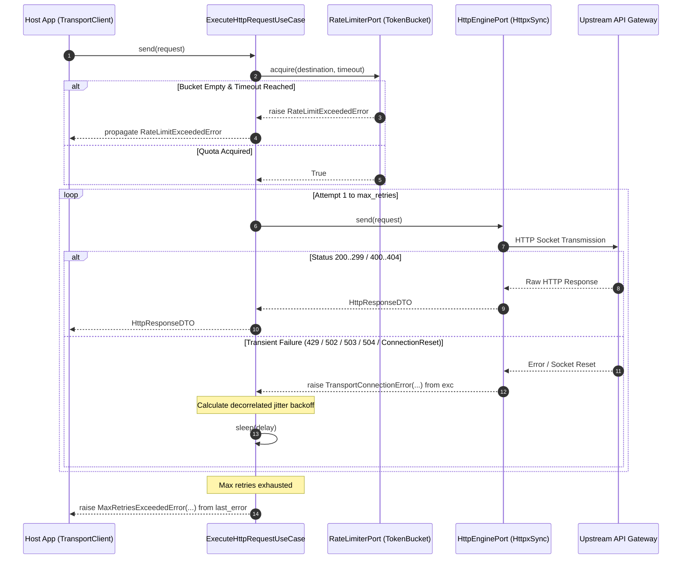

# SDD-005: Hexagonal Architecture Core and Driven Adapter Implementation Architecture

## 1. Introduction and Architectural Motivation

### 1.1 Scope and Objective
This Software Design Document specifies the mechanical implementation of **ADR 0005** (Hexagonal Architecture Component Inventory and Implementation Roadmap). It provides the concrete class structures, protocols, interactor workflows, driven adapter engines, and bootstrap wiring necessary to satisfy the as-built `TransportClient` and `AsyncTransportClient` driving facades.

### 1.2 The Skeptic Test (Why Build Hexagonal Ports & Adapters?)
Without an explicit Ports and Adapters topology:
1. **Third-Party Coupling (`RISK-05`):** Consumer applications (`ed-capi`, `ed-eddn`, `ed-connectors`) directly instantiate `httpx` or `aiohttp` clients. If a third-party library introduces breaking API changes or dependency conflicts, every package in the fleet breaks simultaneously.
2. **Untestable Failure Scenarios:** Simulating network disconnects, token bucket exhaustion, and offline SQLite buffering requires fragile monkeypatching rather than clean mock adapter injection.
3. **Event-Loop Deadlocks (`RISK-07`):** Unifying sync and async runtimes without dedicated interactors leads to blocking calls inside reactive loops.
4. **SQLite Concurrency Corruption (`RISK-11`):** Naive database writes across background threads trigger `database is locked` or corrupt spool storage on sudden power loss (e.g. Steam Deck battery death).

### 1.3 The Vacation Test
This specification provides complete class definitions, method signatures, transaction protocols, sequence flows, and verification gates such that any independent engineer can build, test, and maintain this subsystem without consulting the original author.

---

## 2. Visual Architecture Models

### 2.1 Complete Hexagonal Topology Model

```mermaid
flowchart TD
    subgraph DrivingLayer ["1. Driving Adapter Plane (src/ed_transport/adapters/driving/)"]
        tc["TransportClient<br/>(Sync Facade)"]
        atc["AsyncTransportClient<br/>(Async Facade)"]
    end

    subgraph DrivingPorts ["2. Driving Ports Plane (src/ed_transport/core/ports/driving/)"]
        tp["TransportPort"]
        atp["AsyncTransportPort"]
        smp["SpoolManagerPort"]
        tsp["TelemetryStreamPort"]
    end

    subgraph CoreUseCases ["3. Core Use-Case Interactors (src/ed_transport/core/use_cases/)"]
        ucHttp["ExecuteHttpRequestUseCase"]
        ucAsyncHttp["AsyncExecuteHttpRequestUseCase"]
        ucDrain["DrainSpoolBufferUseCase"]
        ucAsyncDrain["AsyncDrainSpoolBufferUseCase"]
        ucStream["ConsumeTelemetryStreamUseCase"]
    end

    subgraph DrivenPorts ["4. Driven SPI Ports Plane (src/ed_transport/core/ports/driven/)"]
        spiHttp["HttpEnginePort"]
        spiAsyncHttp["AsyncHttpEnginePort"]
        spiLimiter["RateLimiterPort"]
        spiSpool["SpoolStoragePort"]
        spiStream["StreamEnginePort"]
    end

    subgraph DrivenAdapters ["5. Driven Infrastructure Adapters (src/ed_transport/adapters/driven/)"]
        adHttpxSync["HttpxSyncEngineAdapter"]
        adHttpxAsync["HttpxAsyncEngineAdapter"]
        adLimiter["TokenBucketRateLimiter"]
        adSqlite["SqliteSpoolStorageAdapter"]
        adMemSpool["MemorySpoolStorageAdapter"]
        adSse["SseStreamEngineAdapter"]
    end

    tc --> tp
    tc --> smp
    atc --> atp
    atc --> smp
    atc --> tsp

    ucHttp -.->|implements| tp
    ucAsyncHttp -.->|implements| atp
    ucDrain -.->|implements| smp
    ucAsyncDrain -.->|implements| smp
    ucStream -.->|implements| tsp

    ucHttp --> spiHttp
    ucHttp --> spiLimiter
    ucAsyncHttp --> spiAsyncHttp
    ucAsyncHttp --> spiLimiter
    ucDrain --> spiSpool
    ucDrain --> tp
    ucAsyncDrain --> spiSpool
    ucAsyncDrain --> atp
    ucStream --> spiStream

    adHttpxSync -.->|implements| spiHttp
    adHttpxAsync -.->|implements| spiAsyncHttp
    adLimiter -.->|implements| spiLimiter
    adSqlite -.->|implements| spiSpool
    adMemSpool -.->|implements| spiSpool
    adSse -.->|implements| spiStream
```



### 2.2 Resilient Dispatch with Token Bucket & Jitter Flow



---

## 3. Component Specifications

### 3.1 Core Domain Layer (`src/ed_transport/core/domain/`)

#### A. New Exception (`src/ed_transport/core/domain/exceptions.py`)

```python
class SpoolStorageCorruptError(DomainError):
    """Raised when an unrecoverable database or storage corruption is detected."""

    def __init__(self, storage_path: str, details: str = "") -> None:
        msg = f"Spool storage file at '{storage_path}' is corrupted"
        if details:
            msg += f": {details}"
        super().__init__(msg)
        self.storage_path = storage_path
        self.details = details
```

#### B. Updated SpoolConfig (`src/ed_transport/core/domain/models.py`)

```python
@dataclass(frozen=True)
class SpoolConfig:
    max_capacity_bytes: int = 50 * 1024 * 1024  # 50 MB
    storage_path: str = ""                       # Empty = in-memory spool
    overflow_strategy: str = "drop_oldest"       # "drop_oldest" or "reject"
    auto_recover_corrupt: bool = False           # If True, renames corrupt db and recreates
```

#### C. SpoolRecordDTO (`src/ed_transport/core/ports/dto/transport_dto.py`)

```python
@dataclass(frozen=True)
class SpoolRecordDTO(DataTransferObject):
    sequence_id: int
    request: HttpRequestDTO
    created_at: float
    retry_count: int = 0
```

---

### 3.2 Driven Secondary SPI Ports (`src/ed_transport/core/ports/driven/`)

All secondary ports reside under `core/ports/driven/` and inherit from `abc.ABC`:

```python
# http_engine_port.py
class HttpEnginePort(abc.ABC):
    @abc.abstractmethod
    def send(self, request: HttpRequestDTO) -> HttpResponseDTO: ...
    @abc.abstractmethod
    def close(self) -> None: ...

# async_http_engine_port.py
class AsyncHttpEnginePort(abc.ABC):
    @abc.abstractmethod
    async def send_async(self, request: HttpRequestDTO) -> HttpResponseDTO: ...
    @abc.abstractmethod
    async def aclose() -> None: ...

# rate_limiter_port.py
class RateLimiterPort(abc.ABC):
    @abc.abstractmethod
    def acquire(self, destination: str, timeout: float | None = None) -> bool: ...
    @abc.abstractmethod
    async def acquire_async(self, destination: str, timeout: float | None = None) -> bool: ...

# spool_storage_port.py
class SpoolStoragePort(abc.ABC):
    @abc.abstractmethod
    def push(self, record: SpoolRecordDTO) -> None: ...
    @abc.abstractmethod
    def pop(self) -> SpoolRecordDTO | None: ...
    @abc.abstractmethod
    def peek(self) -> SpoolRecordDTO | None: ...
    @abc.abstractmethod
    def count(self) -> int: ...
    @abc.abstractmethod
    def size_bytes(self) -> int: ...
    @abc.abstractmethod
    def clear(self) -> None: ...
    @abc.abstractmethod
    def close(self) -> None: ...

# stream_engine_port.py
class StreamEnginePort(abc.ABC):
    @abc.abstractmethod
    def open_stream(self, endpoint: str, topic: str) -> AsyncIterator[RawStreamEventDTO]: ...
```

---

### 3.3 Core Use-Case Interactors (`src/ed_transport/core/use_cases/`)

#### A. `ExecuteHttpRequestUseCase`
* **Port Implemented:** `TransportPort`.
* **Dependencies Injected:** `HttpEnginePort`, `RateLimiterPort`, `RetryConfig`, `RateLimitConfig`.
* **Execution Flow:**
  1. Identifies destination key from `request.url`.
  2. Invokes `rate_limiter.acquire(destination, timeout)`. Raises `RateLimitExceededError` if quota cannot be fulfilled within timeout.
  3. Enters retry loop (1 to `retry_config.max_retries`):
     - Dispatches via `http_engine.send(request)`.
     - Returns `HttpResponseDTO` immediately if status is non-retriable (< 429, or 400..428).
     - If status in `{429, 502, 503, 504}` or `TransportConnectionError` is caught:
       - Computes decorrelated jitter delay: $\min(M, B \times 2^{\text{attempt}} + \text{uniform}(0, J \times B))$.
       - Sleeps for calculated duration.
  4. If retries exhausted, raises `MaxRetriesExceededError` chaining the last failure.

#### B. `AsyncExecuteHttpRequestUseCase`
* **Port Implemented:** `AsyncTransportPort`.
* **Dependencies Injected:** `AsyncHttpEnginePort`, `RateLimiterPort`, `RetryConfig`, `RateLimitConfig`.
* **Execution Flow:** Asynchronous equivalent utilizing `await rate_limiter.acquire_async()`, `await http_engine.send_async()`, and non-blocking `await asyncio.sleep()`.

#### C. `DrainSpoolBufferUseCase`
* **Port Implemented:** `SpoolManagerPort`.
* **Dependencies Injected:** `SpoolStoragePort`, `TransportPort`.
* **Execution Flow:**
  1. Inspects `spool_storage.count()`. Returns 0 if empty.
  2. While records remain and client is operational:
     - Peeks next `SpoolRecordDTO` in FIFO order.
     - Attempts dispatch via `transport_port.send(record.request)`.
     - On HTTP success (`200 <= status < 300`): pops record from storage.
     - On non-recoverable client error (`400 <= status < 500`): pops and discards invalid payload.
     - On network disconnect: aborts draining loop, preserving remaining buffered records.
  3. Returns total dispatched count.

#### D. `ConsumeTelemetryStreamUseCase`
* **Port Implemented:** `TelemetryStreamPort`.
* **Dependencies Injected:** `StreamEnginePort`.
* **Execution Flow:**
  1. Maintains internal monotonic `last_event_id: str`.
  2. Enters continuous async generator loop:
     - Opens stream via `stream_engine.open_stream(endpoint, topic)`.
     - Yields each `RawStreamEventDTO` to caller.
     - Tracks received `event_id`.
     - On socket drop, executes jittered reconnect loop up to 60s clamp, injecting `Last-Event-ID` header.
  3. Terminates cleanly when caller cancels generator or closes client.

---

### 3.4 Driven Infrastructure Adapters (`src/ed_transport/adapters/driven/`)

#### A. `SqliteSpoolStorageAdapter` (`src/ed_transport/adapters/driven/spool/sqlite_spool.py`)
* **Underlying Engine:** Python standard library `sqlite3`.
* **Database Schema:**
  ```sql
  CREATE TABLE IF NOT EXISTS spool_records (
      sequence_id INTEGER PRIMARY KEY AUTOINCREMENT,
      correlation_id TEXT NOT NULL,
      url TEXT NOT NULL,
      method TEXT NOT NULL,
      headers_json TEXT NOT NULL,
      body BLOB NOT NULL,
      timeout REAL NOT NULL,
      created_at REAL NOT NULL,
      retry_count INTEGER DEFAULT 0,
      size_bytes INTEGER NOT NULL
  );
  CREATE INDEX IF NOT EXISTS idx_spool_sequence ON spool_records(sequence_id ASC);
  ```
* **Concurrency & Safety Invariants (`RISK-11`):**
  - Executes `PRAGMA journal_mode=WAL;` and `PRAGMA busy_timeout=5000;`.
  - Guards transactions with `threading.RLock()`.
  - Catches `sqlite3.DatabaseError`: raises `SpoolStorageCorruptError` unless `auto_recover_corrupt=True`.
  - Enforces `max_capacity_bytes`: if total bytes exceeds quota:
    - If `overflow_strategy == "reject"`: raises `SpoolCapacityExceededError`.
    - If `overflow_strategy == "drop_oldest"`: deletes records sequentially starting from lowest `sequence_id`.

#### B. `HttpxSyncEngineAdapter` & `HttpxAsyncEngineAdapter`
* **Underlying Engine:** `httpx.Client` and `httpx.AsyncClient`.
* **Exception Translation Boundary (`ADR-0004`):**
  - `httpx.ConnectTimeout` / `httpx.ReadTimeout` $\to$ `TransportTimeoutError`.
  - `httpx.NetworkError` / `socket.gaierror` $\to$ `TransportConnectionError`.
  - Enforces causal chaining (`raise ... from exc`).

#### C. `TokenBucketRateLimiter`
* **Underlying Mechanism:** Thread-safe in-memory token bucket tracking remaining capacity, last refill timestamp, and fill rate per destination string.

---

## 4. Documentation Implementation Steps

In accordance with Diataxis standards, the implementation of this subsystem must include:

1. **`docs/reference/transport_client.md`**: Update reference with `create_transport_client()`, `create_async_transport_client()`, driven SPI ports, and new exception `SpoolStorageCorruptError`.
2. **`docs/reference/configuration.md`**: New reference manual detailing `RateLimitConfig`, `RetryConfig`, and `SpoolConfig` parameters.
3. **`docs/how-to/spool_offline_requests.md`**: Update guide detailing SQLite persistent configuration, corruption recovery flags, and capacity bounds.
4. **`docs/how-to/configure_rate_limits.md`**: New guide for setting destination-specific burst limits and fill rates.
5. **`docs/how-to/initialize_production_client.md`**: New guide showing one-line factory initialization for downstream daemon packages (`ed-capi`, `ed-eddn`).
6. **`docs/tutorials/quickstart_resilient_dispatch.md`**: New hands-on tutorial demonstrating end-to-end HTTP dispatch, retry recovery, and offline spool draining.
7. **`docs/explanation/offline_spool_architecture.md`**: New conceptual architectural overview of WAL-mode SQLite circular buffers and cross-platform concurrency safety.

---

## 5. Verification & Test Plan

1. **Unit Tests (`tests/unit/`):**
   * `test_execute_request_use_case.py`: Verifies retries, jitter calculation, and timeout translation.
   * `test_token_bucket.py`: Verifies rate limit bursts, refill rates, and thread safety.
   * `test_sqlite_spool.py`: Verifies FIFO ordering, byte capacity pruning, corruption handling, and `reject` strategy.
   * `test_memory_spool.py`: Verifies fast in-memory circular buffer.
2. **Architectural Boundary Tests (`tests/architecture/test_boundaries.py`):**
   * Confirms `core/` has zero imports of `httpx`, `sqlite3`, or OS libraries.
   * Confirms all driven adapters implement their respective SPI ports.
   * Confirms no unmanaged background worker threads exist in use cases.
3. **Tier 2 Gates:**
   * `.venv/bin/python scripts/verify.py`
   * `./scripts/run_wine_tests.sh` (validating SQLite locking and socket errors under Windows NT simulation).
