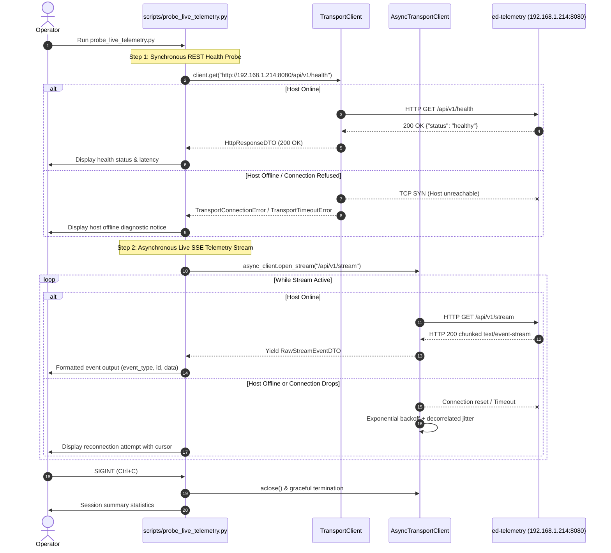

# Software Design Document: Live Telemetry Integration Probe Harness

## 1. Introduction and Scope

### 1.1 Purpose
This Software Design Document (SDD) articulates the technical architecture, execution flow, command-line interface, and diagnostic rendering for `scripts/probe_live_telemetry.py`. The tool provides a live operational verification harness connecting `ed-transport` to a remote or local instance of the `ed-telemetry` daemon (defaulting to host `michael-desktop` at `192.168.1.214:8080`).

### 1.2 Traceability
* **ADR 0007**: Live Telemetry Integration Probe Harness and Host Verification.
* **ADR 0002**: Driving Adapter Facade Definition and API Surface.
* **ADR 0005**: Hexagonal Architecture Implementation Roadmap.
* **Use Cases**:
  * `UC-01`: Resilient Telemetry and Metric Dispatch.
  * `UC-03`: Daemon Server-Sent Events (SSE) IPC Stream Consumption.

---

## 2. CLI Interface & Execution Specification

### 2.1 Invocation Syntax
```bash
.venv/bin/python scripts/probe_live_telemetry.py [OPTIONS]
```

### 2.2 Options & Parameter Defaults
| Option | Type | Default | Description |
| :--- | :--- | :--- | :--- |
| `--host` | `str` | `192.168.1.214` | Host IP or hostname of the target `ed-telemetry` instance. |
| `--port` | `int` | `8080` | Port of the target `ed-telemetry` daemon. |
| `--health-endpoint` | `str` | `/api/v1/health` | REST health check path to probe synchronously. |
| `--stream-endpoint` | `str` | `/api/v1/stream` | Server-Sent Events stream path to subscribe asynchronously. |
| `--topic` | `str` | `None` | Optional SSE topic filter (e.g. `journal`, `status`). |
| `--timeout` | `float` | `5.0` | Socket timeout in seconds for synchronous probe requests. |
| `--mode` | `str` | `both` | Execution mode: `rest` (health only), `stream` (SSE only), or `both`. |
| `--max-events` | `int` | `0` | Maximum number of SSE events to capture before exiting (0 = indefinite). |

---

## 3. Operational Workflow



---

## 4. Error Handling and Resilience

1. **Host Unreachable at Startup**:
   If `michael-desktop` is powered off, the script informs the operator with a non-fatal warning, prints the connection failure detail, and enters the streaming loop where `ed-transport`'s exponential backoff and jitter handle automatic reconnection.
2. **Terminal Cancellation (`SIGINT`)**:
   Cleanly traps KeyboardInterrupt, terminates active streams without leaking async tasks, and prints aggregate metrics: total connection time, events received, and last cursor recorded.
